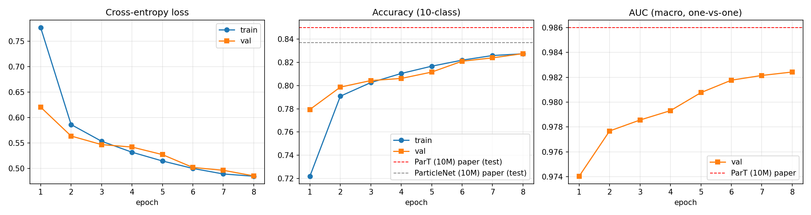
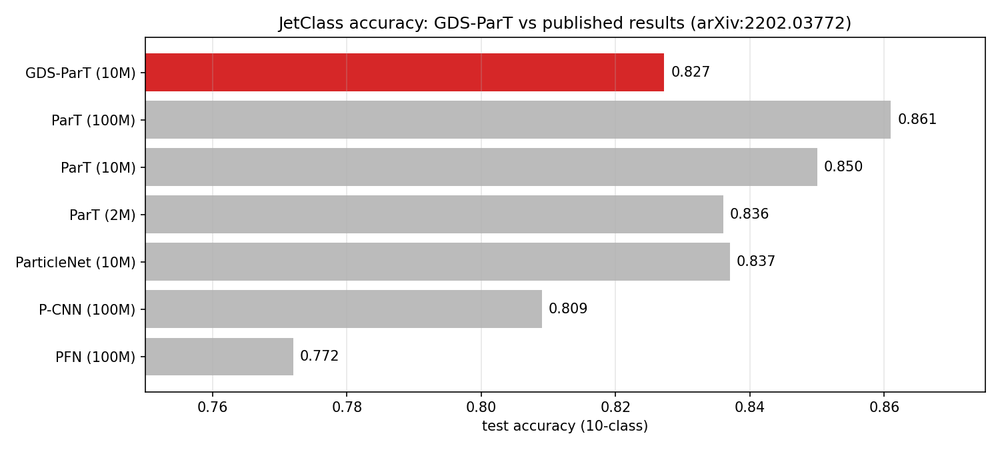
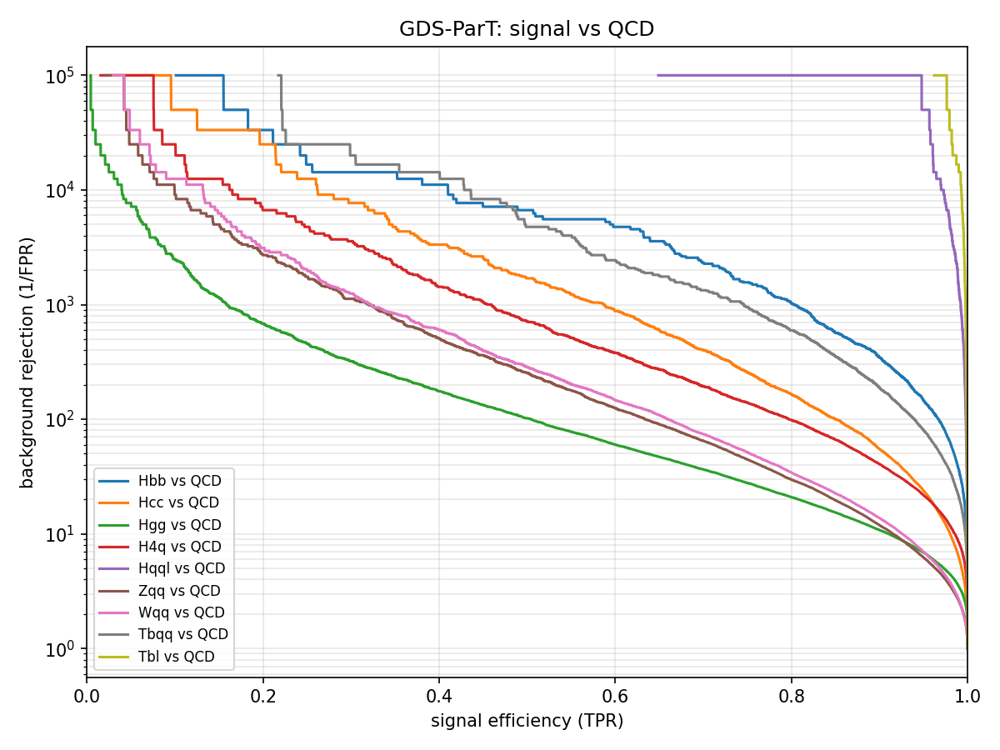
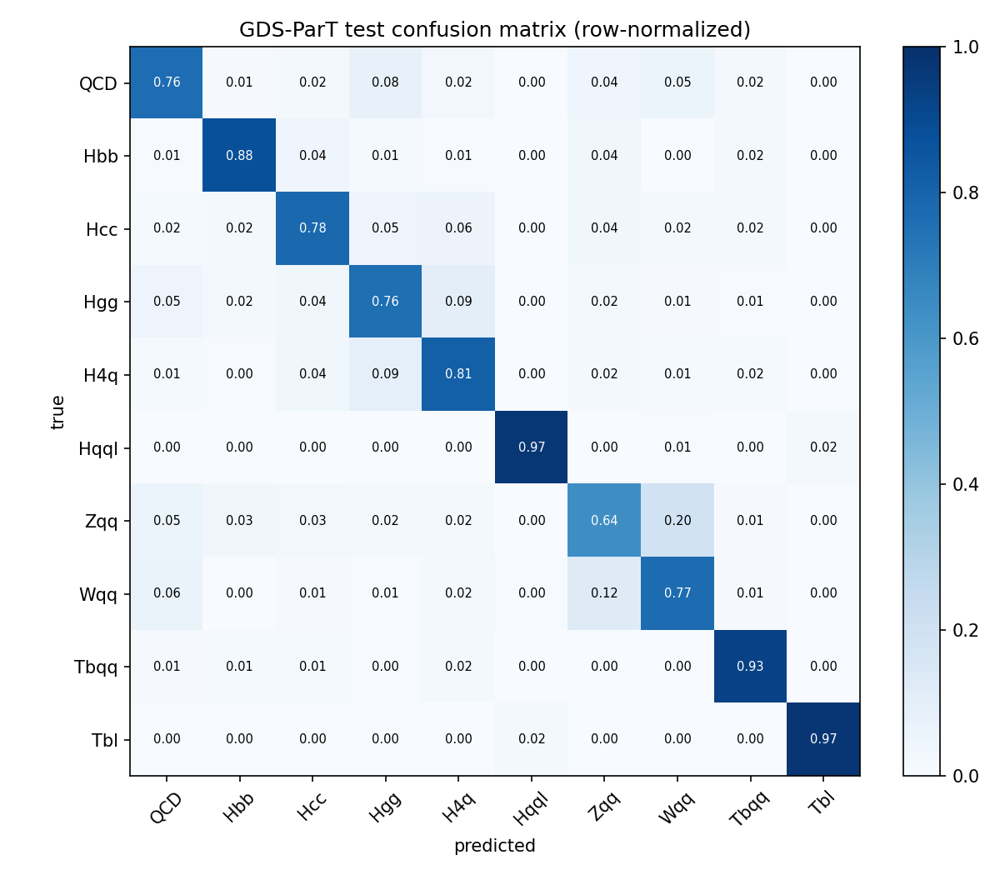

# GDS-ParT results — train_10M

## Setup

- Training set: `D:\JetClass\train_10M` (train_10M)
- Validation set: `D:\JetClass\val` — 1,000,000 jets
- Test set: `D:\JetClass\test` — **1,000,000 jets** (balanced, 10 classes)
- Model: 1,280,684 parameters; embed_dim=128, layers=6, heads=8, pairwise_embed_dim=64, max_particles=128
- Optimizer: AdamW lr=0.001, wd=0.01, batch=512, 8 epochs, warmup 5% + cosine, AMP
- Checkpoint used for test: best validation accuracy (epoch 8)

## Headline test metrics

| Metric | Value |
|---|---|
| Accuracy (10-class) | **0.8272** |
| AUC (macro, one-vs-one) | **0.9824** |
| Cross-entropy loss | 0.4850 |

## Comparison with the ParT paper (JetClass test set)

Published numbers from Qu et al., *Particle Transformer for Jet Tagging*, ICML 2022 (arXiv:2202.03772), Tables 1 and 3. Higher is better for every column.

| Model | Train jets | Params | Accuracy | AUC | Hbb_Rej50 | Hcc_Rej50 | Hgg_Rej50 | H4q_Rej50 | Hqql_Rej99 | Tbqq_Rej50 | Tbl_Rej99.5 | Wqq_Rej50 | Zqq_Rej50 |
|---|---|---|---|---|---|---|---|---|---|---|---|---|---|
| PFN (100M) | 100M | 86.1k | 0.772 | 0.9714 | 2,924 | 841 | 75 | 198 | 265 | 797 | 721 | 189 | 159 |
| P-CNN (100M) | 100M | 354k | 0.809 | 0.9789 | 4,890 | 1,276 | 88 | 474 | 947 | 2,907 | 2,304 | 241 | 204 |
| ParticleNet (2M) | 2M | 370k | 0.828 | 0.9820 | 5,540 | 1,681 | 90 | 662 | 1,654 | 4,049 | 4,673 | 260 | 215 |
| ParticleNet (10M) | 10M | 370k | 0.837 | 0.9837 | 5,848 | 2,070 | 96 | 770 | 2,350 | 5,495 | 6,803 | 307 | 253 |
| ParticleNet (100M) | 100M | 370k | 0.844 | 0.9849 | 7,634 | 2,475 | 104 | 954 | 3,339 | 10,526 | 11,173 | 347 | 283 |
| ParT (2M) | 2M | 2.14M | 0.836 | 0.9834 | 5,587 | 1,982 | 93 | 761 | 1,609 | 6,061 | 4,474 | 307 | 236 |
| ParT (10M) | 10M | 2.14M | 0.850 | 0.9860 | 8,734 | 3,040 | 110 | 1,274 | 3,257 | 12,579 | 8,969 | 431 | 324 |
| ParT (100M) | 100M | 2.14M | 0.861 | 0.9877 | 10,638 | 4,149 | 123 | 1,864 | 5,479 | 32,787 | 15,873 | 543 | 402 |
| ParT plain (100M) | 100M | 2.13M | 0.849 | 0.9859 | 9,569 | 2,911 | 112 | 1,185 | 3,868 | 17,699 | 12,987 | 384 | 311 |
| **GDS-ParT (10M)** | 10M | 1.28M | **0.827** | **0.9824** | 6,667 | 1,695 | 102 | 709 | 1,449 | 4,762 | 5,263 | 285 | 254 |

Closest like-for-like reference is **ParT (10M)**: accuracy 0.850, AUC 0.9860. GDS-ParT difference: accuracy -0.023, AUC -0.0036.

### Caveats for a fair reading

- **Test set size**: ours is a 1,000,000-jet balanced subset of the official 20M test split (1 file per class). Accuracy/AUC are stable at this size (stat. error ~0.0004 on accuracy), but high rejection values (e.g. Tbl Rej99.5, Hbb Rej50) rely on very few surviving QCD jets and carry large statistical uncertainty (~10–30%).
- **Training budget**: the paper trains for 1M iterations x batch 512 (~512M jets seen). This run saw 8 x 10M jets on a single 6 GB laptop GPU.
- **Model size**: GDS-ParT here has 1.28M params vs 2.14M for ParT; no class-attention blocks; pairwise information used via Q/K gates instead of attention bias.
- **Optimizer**: AdamW + cosine (ours) vs Lookahead(RAdam) + step decay (paper).
- Rejection uses the paper's definition: Rej_X% = 1/FPR at TPR = X%, with score S/(S+B) and QCD as background.

## Per-class test accuracy (argmax)

| Class | Accuracy |
|---|---|
| QCD | 0.7628 |
| Hbb | 0.8750 |
| Hcc | 0.7807 |
| Hgg | 0.7574 |
| H4q | 0.8133 |
| Hqql | 0.9715 |
| Zqq | 0.6385 |
| Wqq | 0.7659 |
| Tbqq | 0.9334 |
| Tbl | 0.9739 |

## Training history

| Epoch | Train loss | Train acc | Val loss | Val acc | Val AUC |
|---|---|---|---|---|---|
| 1 | 0.7771 | 0.7219 | 0.6204 | 0.7794 | 0.9740 |
| 2 | 0.5861 | 0.7909 | 0.5635 | 0.7987 | 0.9777 |
| 3 | 0.5533 | 0.8026 | 0.5466 | 0.8043 | 0.9786 |
| 4 | 0.5317 | 0.8104 | 0.5418 | 0.8061 | 0.9793 |
| 5 | 0.5144 | 0.8167 | 0.5270 | 0.8116 | 0.9808 |
| 6 | 0.4997 | 0.8219 | 0.5017 | 0.8210 | 0.9818 |
| 7 | 0.4888 | 0.8259 | 0.4961 | 0.8239 | 0.9821 |
| 8 | 0.4844 | 0.8274 | 0.4850 | 0.8275 | 0.9824 |

## Figures

### Training curves

### Accuracy vs published

### Signal vs QCD ROC

### Confusion matrix

